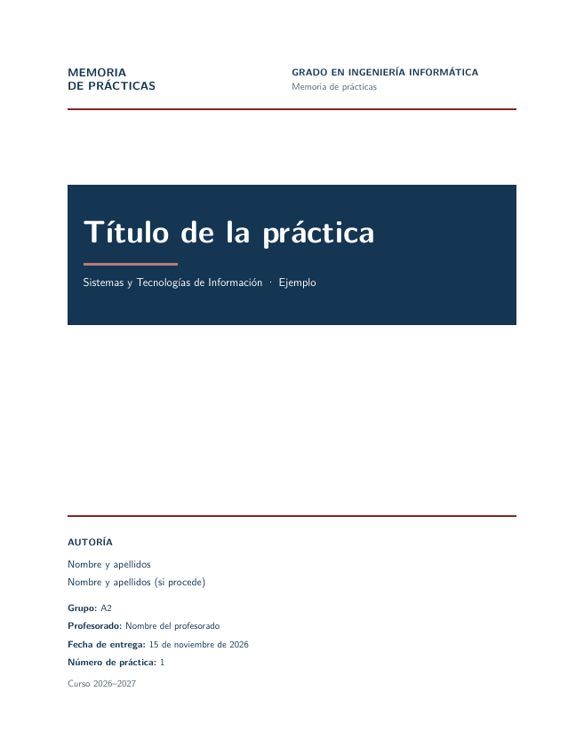
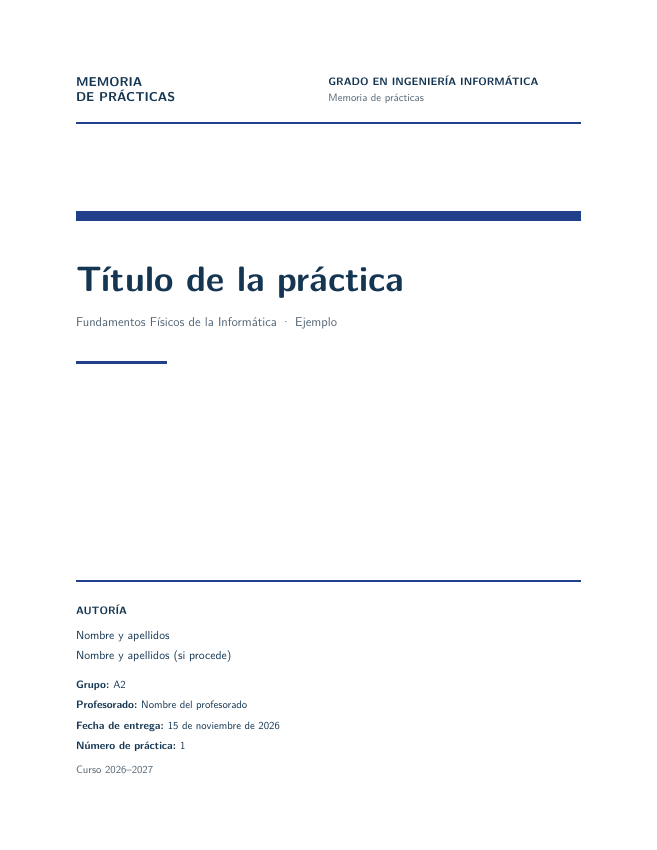
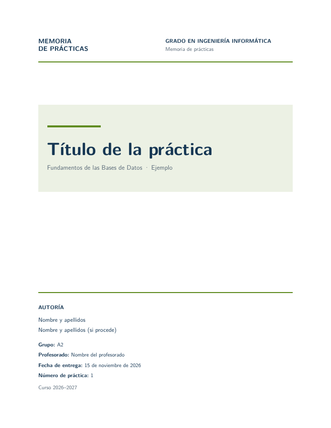
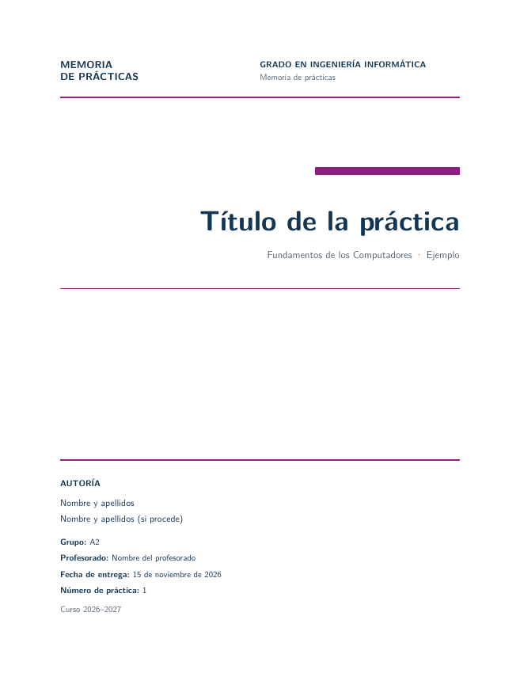

# Plantilla de memorias de prácticas — Ingeniería Informática

Plantilla editable en Markdown para generar memorias en PDF con Pandoc y LuaLaTeX. Es una plantilla orientativa, no un formato oficial de la Universidad de Alicante: adapta portada, estructura y estilo a las instrucciones de cada asignatura.

## Requisitos

- [Pandoc](https://pandoc.org/installing.html), con soporte para archivos de opciones (`--defaults`).
- Una distribución de LaTeX que incluya LuaLaTeX y los paquetes usados por Pandoc (por ejemplo, TeX Live o MiKTeX). Una instalación mínima puede necesitar paquetes adicionales.

## Uso

1. Copia esta carpeta para cada práctica.
2. Edita los datos de la cabecera de `memoria.md`: título, asignatura, autores y curso. Puedes añadir los campos opcionales de portada indicados más abajo.
3. Edita los archivos de `capitulos/` para sustituir el contenido de ejemplo y coloca las imágenes en `recursos/`. Cada archivo contiene una sección principal de la memoria.
4. Para añadir, quitar o reordenar capítulos, modifica la lista `input-files` de `pandoc.yaml`. Mantén `memoria.md` en primer lugar para conservar los datos de la portada.
5. Desde esta carpeta, ejecuta:

   ```sh
   pandoc --defaults=pandoc.yaml -o memoria.pdf
   ```

Abre y revisa el PDF antes de entregarlo. Si falta un paquete `.sty`, instálalo en tu distribución de LaTeX y vuelve a compilar. La portada usa los datos del encabezado y el índice aparece después. Para quitarlo, cambia `table-of-contents` a `false` en `pandoc.yaml`.

### Lista de comprobación antes de entregar

- [ ] La portada contiene el título, la asignatura, la autoría, el curso y los demás datos exigidos.
- [ ] He sustituido los textos, imágenes, tablas, código y citas de ejemplo por el contenido de mi práctica.
- [ ] Las figuras y tablas son legibles, tienen un pie adecuado y se mencionan en el texto.
- [ ] Las citas y la bibliografía corresponden a las fuentes utilizadas y siguen el estilo solicitado.
- [ ] He incluido los anexos necesarios y he eliminado los ejemplos que no correspondan.
- [ ] El PDF se ha generado correctamente y he revisado todas sus páginas, el índice y la numeración.
- [ ] El archivo final y su nombre cumplen las instrucciones de entrega de la asignatura.

## Portadas por asignatura

La plantilla incluye variantes para las asignaturas del [plan de estudios del Grado en Ingeniería Informática de la Universidad de Alicante](https://www.boe.es/diario_boe/txt.php?id=BOE-A-2023-11557), incluidas las optativas. Combinan cuatro composiciones y un color propio para cada asignatura; son propuestas de la plantilla, no diseños oficiales de la UA.

Busca la asignatura en [portadas/asignaturas.tsv](portadas/asignaturas.tsv) y copia su identificador en la cabecera de `memoria.md`. Por ejemplo:

```yaml
title: "Título de la práctica"
portada: programacion-1
subtitle: "Práctica 1"
author:
  - "Nombre y apellidos"
date: "Curso 2026–2027"
lang: es-ES
```

El nombre de la asignatura se añade automáticamente delante del subtítulo. Si no indicas `portada` o usas `portada: general`, se conserva la portada genérica y puedes escribir la asignatura directamente en `subtitle`. También puedes probar una variante sin cambiar el archivo con `pandoc --defaults=pandoc.yaml -M portada=programacion-1 -o memoria.pdf`. Ejecuta Pandoc desde la carpeta de la plantilla para que encuentre el catálogo y el filtro.

### Datos opcionales y logotipo

Añade a la cabecera los campos que necesites; los que omitas no aparecerán. Por ejemplo:

```yaml
grupo: "A2"
profesorado: "Nombre del profesor o profesora"
fecha-entrega: "15 de noviembre de 2026"
numero-practica: "3"
logo-ua: false
```

`logo-ua: false` sustituye el logotipo por una cabecera tipográfica y permite compilar sin `recursos/logo-ua.pdf`. Omite esta opción o usa `logo-ua: true` para mostrar el logotipo. Mantén `date` para el curso académico; `fecha-entrega` es independiente. Si usas `numero-practica`, puedes dejar el subtítulo para otra información y evitar repetir el número.

### Encabezados y numeración

Las páginas de contenido muestran un encabezado discreto y el número de página en el pie; la portada no se numera. Por defecto, el encabezado dice «Memoria de prácticas». Puedes cambiarlo desde la cabecera de `memoria.md`:

```yaml
titulo-corto: "Programación 1"
```

Usa un texto breve para que quepa en una línea. La numeración comienza en la primera página después de la portada.

### Galería de composiciones

Estos ejemplos se muestran sin el logotipo. La última columna del [catálogo](portadas/asignaturas.tsv) indica qué composición corresponde a cada asignatura; el color depende de la asignatura elegida.

| Composición 0: Sistemas y Tecnologías de Información | Composición 1: Fundamentos Físicos de la Informática |
| --- | --- |
|  |  |
| Composición 2: Fundamentos de las Bases de Datos | Composición 3: Fundamentos de los Computadores |
|  |  |

## Markdown y LaTeX

Puedes usar Markdown de Pandoc para encabezados, tablas, imágenes y bloques de código. Las fórmulas se escriben entre `$...$` o `$$...$$`. Para incluir LaTeX sin procesar, usa un bloque con la etiqueta `{=latex}`, como en el ejemplo de `capitulos/03-desarrollo.md`. Añade los paquetes que necesites a `formato.tex`; evita cargar dos veces paquetes ya incluidos por Pandoc. Los bloques de LaTeX puro están pensados para la salida PDF y pueden omitirse al convertir a otros formatos.

En [Desarrollo](capitulos/03-desarrollo.md) encontrarás ejemplos listos para copiar de código, fórmulas, tablas y una figura con pie. También se muestran referencias automáticas a secciones, tablas, figuras y ecuaciones mediante `\label{...}` y `\ref{...}`. Estos ejemplos de referencias usan LaTeX y están destinados a la salida PDF; asigna un identificador distinto a cada elemento y sustituye el contenido y la imagen de ejemplo antes de entregar la memoria.

## Anexos opcionales

El archivo [capitulos/07-anexos.md](capitulos/07-anexos.md) contiene ejemplos para un registro de pruebas y código complementario. Para incluirlos, añade esta línea al final de `input-files` en `pandoc.yaml`, después de las referencias:

```yaml
  - capitulos/07-anexos.md
```

Edita los títulos y contenidos según tu práctica; añade más encabezados de primer nivel (`#`) para crear otros anexos. En el PDF empiezan en una página nueva, aparecen en el índice y se numeran con letras. Puedes referirte a ellos con `\ref{anexo:pruebas}` o con el identificador que definas. El cambio de numeración utiliza LaTeX y está pensado para la salida PDF. Si no necesitas anexos, deja el archivo fuera de `input-files`.

## Bibliografía

La plantilla incluye [referencias.bib](referencias.bib), una cita de ejemplo en el capítulo de desarrollo y un espacio para la bibliografía bajo «Referencias». Sustituye el ejemplo por tus fuentes y cítalas en el texto como `[@clave]`, usando la clave de cada entrada BibTeX. Para citar varias fuentes juntas, escribe `[@clave1; @clave2]`.

El comando habitual de generación del PDF procesa las citas automáticamente. Pandoc incluye en la bibliografía las fuentes citadas y las coloca en el bloque `::: {#refs}` del capítulo de referencias. Para cambiar el estilo, añade `--csl=estilo.csl` al comando. Consulta la [guía de citas de Pandoc](https://pandoc.org/MANUAL.html#citations).

Si no necesitas bibliografía, elimina la cita de ejemplo; puedes dejar vacío `referencias.bib` y conservar el bloque de referencias, o quitar el capítulo de la lista `input-files` de `pandoc.yaml`.

## Compilación automática

El flujo de [GitHub Actions](.github/workflows/compilar.yml) comprueba las citas y compila la memoria con y sin logotipo en cada `push`, solicitud de cambios y ejecución manual. Si termina correctamente, el PDF de ejemplo queda disponible como artefacto de la ejecución durante siete días. El resultado se consulta en la pestaña **Actions** del repositorio; la comprobación comienza cuando los cambios estén subidos a GitHub.

## Licencias y recursos de terceros

- **Plantilla:** el código y la documentación propios del proyecto se distribuyen bajo la [licencia MIT](LICENSE). Esta licencia no se aplica al logotipo ni a otros recursos de terceros.
- **Logotipo de la Universidad de Alicante:** `recursos/logo-ua.pdf` es la versión horizontal en color distribuida por la [Universidad de Alicante](https://imagenycomunicacion.ua.es/es/identidad-visual-corporativa-y-logotipos-ua.html). La marca y el logotipo pertenecen a la UA y se rigen por sus propias [condiciones de uso](https://si.ua.es/es/web-institucional-ua/normativa/condiciones-de-uso.html) y su [manual de identidad visual](https://web.ua.es/es/gabinete-imagen/documentos/ivcorporativaua-2026.pdf). La inclusión del logotipo no concede una licencia abierta sobre él ni implica que esta plantilla sea oficial.
- **Herramientas:** Pandoc y LaTeX son proyectos independientes, sujetos a las licencias de sus respectivas distribuciones y paquetes. No se incluyen en la plantilla.
